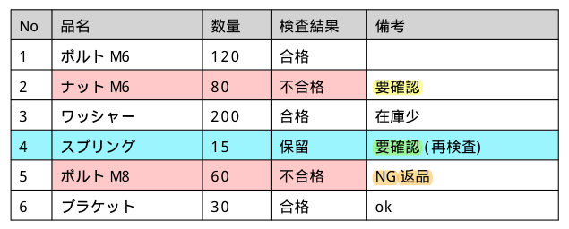
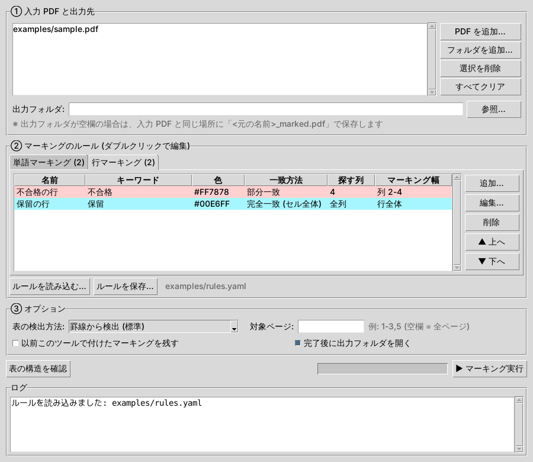

# pdf_auto_marker

PDF 内の **表** を自動で検出し、ルールに従ってマーキング(ハイライト)を付けるツールです。
処理はすべて **ローカルで完結** します(ネットワーク通信・外部サービスは使いません)。



## 機能

| # | 機能 | 設定キー |
|---|------|----------|
| 1 | 表の中の指定した単語を、任意の色でマーキング | `word_rules` |
| 2 | 表の行内に特定の文字がある場合、指定した範囲の幅・任意の色でその行をマーキング | `row_rules` |

- マーキングは PDF の **注釈** として付けます。元の本文は変更しないため、Acrobat などで個別に削除・色変更ができます(印刷にも反映されます)。
- 一致方法: 部分一致 / セル全体の完全一致 / 正規表現
- 全角・半角の揺れ(`ＮＧ` と `NG` など)や英字の大文字・小文字を無視して検索可能
- 表の外にある文字はマーキングしません
- 同じ PDF に再実行すると、以前このツールで付けたマーキングを置き換えます(重複しません)
- 回転したページ、複数ページ、フォルダ単位の一括処理に対応

## 動作環境・インストール

- Python 3.9 以上(Windows / macOS / Linux)

```bash
pip install -r requirements.txt
# またはコマンドとしてインストール
pip install .
```

## 使い方 (GUI)



### 起動

| OS | 起動方法 |
|----|---------|
| Windows | `start_gui.bat` をダブルクリック |
| macOS | `start_gui.command` をダブルクリック(初回は右クリック →「開く」) |
| 共通 | `python -m pdf_auto_marker.gui`(`pip install .` 済みなら `pdf-auto-marker-gui`) |

> GUI は Python 標準の tkinter を使います。Windows / macOS の公式 Python には同梱されています。
> Linux で `No module named 'tkinter'` と出る場合は `sudo apt install python3-tk` などで追加してください。

### 操作の流れ

1. **① 入力 PDF と出力先** — 「PDF を追加」または「フォルダを追加」で対象を選びます。出力フォルダが空欄なら入力と同じ場所に `<元の名前>_marked.pdf` で保存します。
2. **② マーキングのルール** — 「単語マーキング」「行マーキング」の各タブで「追加…」を押してルールを作成します(ダブルクリックで編集、▲▼で順番変更)。
   - 色は「色を選ぶ…」のカラーピッカー、または `#FF0000` のような 16 進で指定
   - 行マーキングの幅は「行全体」「列の範囲(例: `2-4`)」「横位置 (pt)」から選択
   - 列番号や横位置は「**表の構造を確認**」ボタンで確認できます
3. **③ オプション** — 必要に応じて表の検出方法・対象ページを指定します。
4. **▶ マーキング実行** — 結果はログに表示され、完了後に出力フォルダが開きます。

作ったルールは「ルールを保存…」で YAML ファイルに保存でき、次回は「ルールを読み込む…」で再利用できます(コマンドラインと共通の形式です)。

## 使い方 (コマンドライン)

### 1. 表の構造を確認する

列番号(1 始まり)を確認するため、まず `--inspect` で検出結果を表示します。

```bash
python -m pdf_auto_marker examples/sample.pdf --inspect
```

```
[ページ 1] 表 1: 7 行 x 5 列  位置(pt) x=97.6-497.6, y=102.0-256.0
    列の横位置(pt): 1列:97.6-127.6, 2列:127.6-237.6, 3列:237.6-287.6, 4列:287.6-357.6, 5列:357.6-497.6
    行  1: No | 品名 | 数量 | 検査結果 | 備考
    行  2: 1 | ボルト M6 | 120 | 合格 |
    行  3: 2 | ナット M6 | 80 | 不合格 | 要確認
    ...
```

### 2. ルールを書いてマーキングする

```bash
python -m pdf_auto_marker examples/sample.pdf -c examples/rules.yaml -o result.pdf -v
```

| オプション | 説明 |
|-----------|------|
| `-c, --config` | ルール設定ファイル(YAML / JSON) |
| `-o, --output` | 出力ファイル。入力が複数(またはフォルダ)の場合は出力フォルダ。省略時は `<元の名前>_marked.pdf` |
| `-p, --pages` | 対象ページ(例: `1-3,5`) |
| `--strategy` | 表の検出方法 `lines`(既定)/ `lines_strict` / `text`(罫線のない表) |
| `--inspect` | マーキングせず、検出した表の行・列を表示 |
| `--keep-previous` | 以前付けたマーキングを残したまま追加する |
| `-v, --verbose` | マーキング箇所を 1 件ずつ表示 |

フォルダ内の PDF を一括処理する例:

```bash
python -m pdf_auto_marker ./input_pdfs -c rules.yaml -o ./output
```

## ルール設定ファイル

完全な例は [examples/rules.yaml](examples/rules.yaml) を参照してください。

```yaml
defaults:
  opacity: 0.4           # 透明度 (0〜1)
  mode: contains         # contains(部分一致) / exact(セル全体が一致) / regex(正規表現)
  case_sensitive: false  # 英字の大文字・小文字を区別するか
  normalize: true        # 全角/半角の違いを無視するか

# 機能1: 表の中の指定単語をマーキング
word_rules:
  - name: 要確認
    words: ["要確認", "再検査"]
    color: "#FFFF00"
    columns: [5, 5]        # (任意) 検索する列を限定

# 機能2: 行内に特定の文字があれば、その行を指定範囲の幅でマーキング
row_rules:
  - name: 不合格の行
    keywords: ["不合格"]
    color: [255, 120, 120]
    search_columns: 4      # (任意) キーワードを探す列。省略時は全列
    mark_columns: [2, 4]   # (任意) マーキングする列範囲。省略時は行全体
    # x_range: [60, 400]   # (任意) mark_columns の代わりに横位置を pt で直接指定
    padding: 0             # (任意) 上下左右の余白 (pt)
```

### 指定方法の詳細

- **色 `color`**: `"#FF0000"` / `"#F00"` / `[255, 0, 0]` / 色名
  (`yellow`, `red`, `green`, `blue`, `orange`, `pink`, `cyan`, `purple`, `gray`,
  `黄色`, `赤`, `緑`, `青`, `オレンジ`, `ピンク`, `水色`, `紫`, `灰色`)
- **列範囲** (`columns` / `search_columns` / `mark_columns`): 1 始まり・両端を含む。
  `3`(3 列目のみ)、`[2, 4]` または `"2-4"`(2〜4 列目)、`[2, -1]`(2 列目〜最終列)、`all`(全列)
- **`x_range`**: ページ左端からの距離(pt, 1pt = 1/72 インチ)。`--inspect` に表示される「列の横位置」を参考にしてください
- 各ルールで `opacity` / `mode` / `case_sensitive` / `normalize` を個別に上書きできます
- 1 つのセルの中で折り返された文字列は、つなげて 1 つの文字列として検索します

## Python から使う

```python
from pdf_auto_marker import load_config, mark_pdf

config = load_config("rules.yaml")          # dict を渡すことも可能
result = mark_pdf("in.pdf", "out.pdf", config)
for hit in result.hits:
    print(hit.page, hit.table, hit.row, hit.column, hit.text)
```

## 制限事項

- テキスト情報を持つ PDF が対象です。スキャン画像のみの PDF は、事前に OCR(Acrobat など)でテキスト化してください。
- 表の検出は罫線を基準にしています。罫線のない表は `--strategy text` を試してください(精度は表のレイアウトに依存します)。
- パスワード付き PDF には対応していません。

## 開発

```bash
pip install -e ".[dev]"
python tools/make_sample_pdf.py examples/sample.pdf   # サンプル PDF を再生成
python -m pytest
```

GUI のコードは `pdf_auto_marker/gui.py`、マーキング処理は `pdf_auto_marker/marker.py` にあります(GUI とコマンドラインは同じ処理を呼び出します)。

## ライセンスについて

PDF 処理に [PyMuPDF](https://pymupdf.readthedocs.io/) を使用しています。PyMuPDF は AGPL-3.0(または商用ライセンス)です。
社内でローカル利用する分には問題ありませんが、本ツールを改変して外部に配布・サービス提供する場合は AGPL の条件に注意してください。
